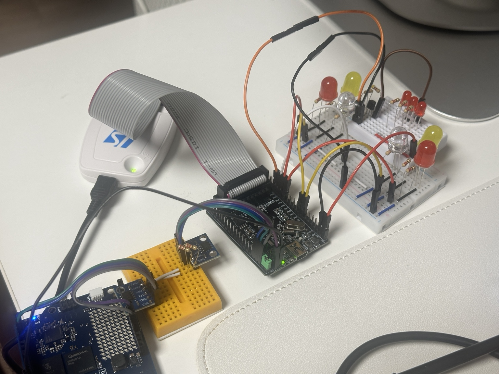
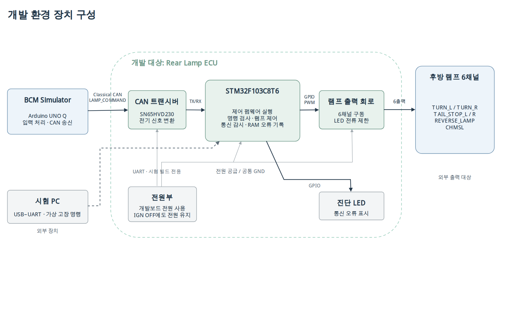

# Vehicle Lamp ECU

STM32F103C8T6 기반 후방 램프 제어 프로젝트. Arduino UNO Q를 BCM 시뮬레이터로 사용.

## 전체 구성

위 그림은 목표 구성. UART 고장 주입과 진단 LED는 후속 구현 범위.

## 설계에서 고려한 조건

- 방향지시보다 비상등 우선. 비상등 해제 시 현재 IGN과 방향 입력으로 모드 결정
- 미등과 제동등은 같은 LED 사용. TIM3 PWM으로 미등 20%, 제동 100% 구분
- CAN 메시지는 이벤트가 아닌 현재 입력 상태 전달. 같은 명령을 반복 수신해도 점멸 위상 유지
- 시작 시 출력 OFF. 유효 명령 미수신 또는 마지막 유효 수신 후 200ms 경과 시 전 채널 소등
- CAN ID, 프레임 형식, DLC, TURN 값과 예약 비트 검사. 무효 프레임은 수신 시각 갱신 제외

## 현재 구현

| 구분 | 상태 |
|---|---|
| 실물 출력 | 6채널, LED 9개 구성. GPIO 점등·400ms 점멸·PWM 밝기 변경 확인 |
| CAN | DBC와 송수신 코드 작성, 배선·전원·종단저항 확인. 정상 프레임 수신과 램프 연동은 디버깅 중 |
| 제어 로직 | 우선순위·IGN 조건·200ms 타임아웃 코드 작성. CAN 연동 동작 확인 전 |
| 후속 작업 | 스위치 입력, UART 진단, KiCad 회로도, SWE.4~6 검증 |

## A-SPICE 참고 범위

SWE.1 요구사항 → SWE.2 구조·인터페이스 설계 → SWE.3 구현 순서로 진행.
정식 심사나 프로세스 준수 인증을 의미하지 않으며, SWE.4~6 시험 결과는 아직 없음.

| 산출물 | 위치 |
|---|---|
| 요구사항·연결표 | [SWE.1](docs/%5BSWE.1%5Drequirements.md) / [연결표](docs/%5BSWE.1%5Dtraceability.md) |
| 정적·동적 아키텍처 | [SWE.2](docs/%5BSWE.2%5Darchitecture.md) |
| CAN 신호 설계 | [DBC](can/vehicle-lamp.dbc) / [SavvyCAN·cantools 기록](docs/%5BSWE.2%5Dcan-interface.md) |
| STM32·UNO Q 코드와 실행 방법 | [firmware](firmware/README.md) |

[작업 목록](TASK.md) / [문서 목차](docs/README.md)
