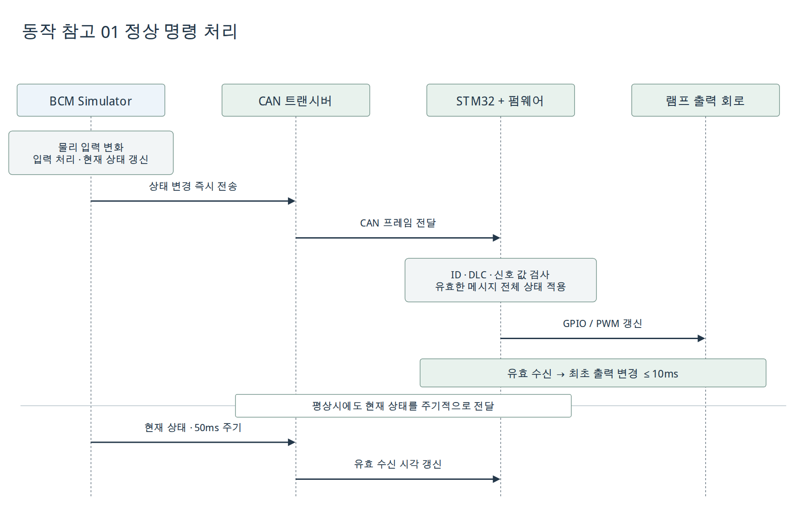
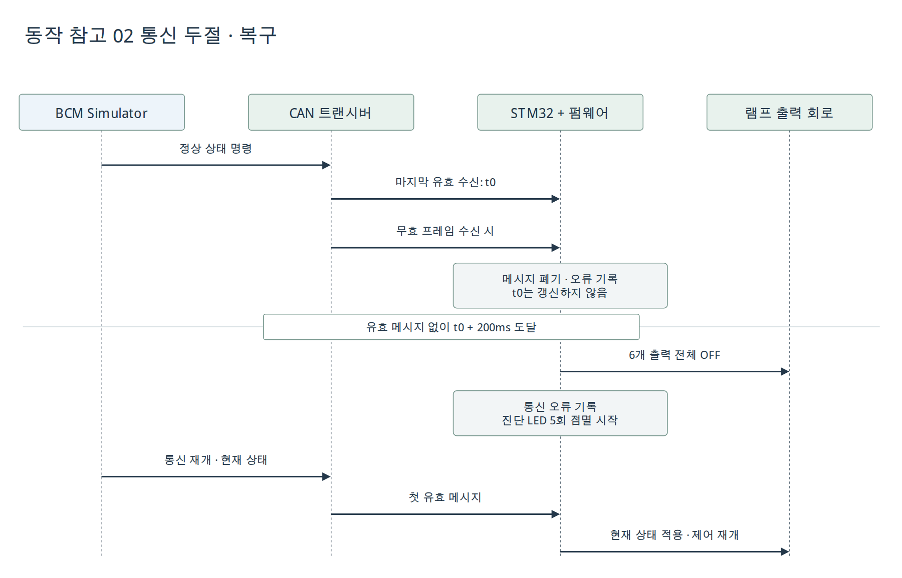
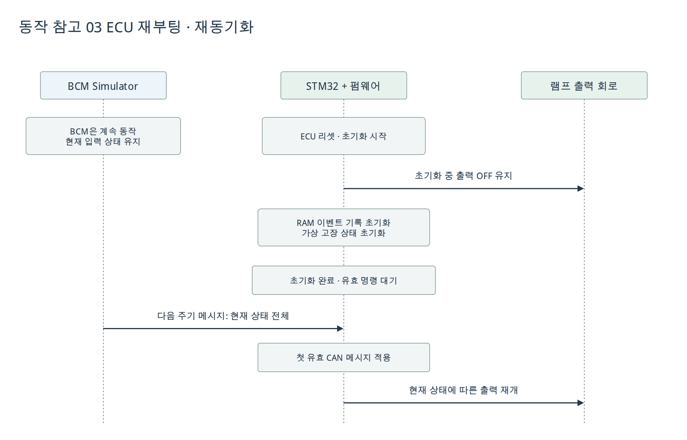
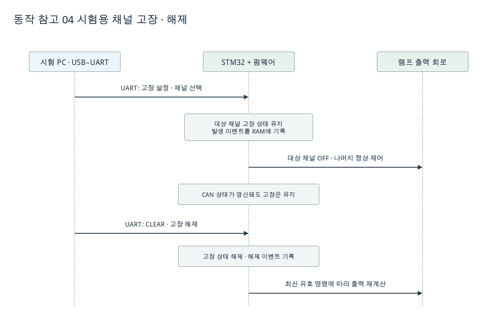

# SWE.1 동작 시나리오

대상: 외부 입력에 대한 ECU의 관측 가능한 동작. SW 내부 모듈 시퀀스와 구분.
[diagrams.net 편집 원본](../diagrams/behavior-reference.drawio).

## 정상 명령

관련 SW 요구사항: SWR-001~011,019.

## 통신 두절·복구

관련 SW 요구사항: SWR-003,013~015,017.

## 재부팅

관련 SW 요구사항: SWR-012,018.

## 가상 고장·CLEAR

관련 SW 요구사항: SWR-016~018.

시간 표기는 설계 목표. 실제 측정·합격 결과 제외.
