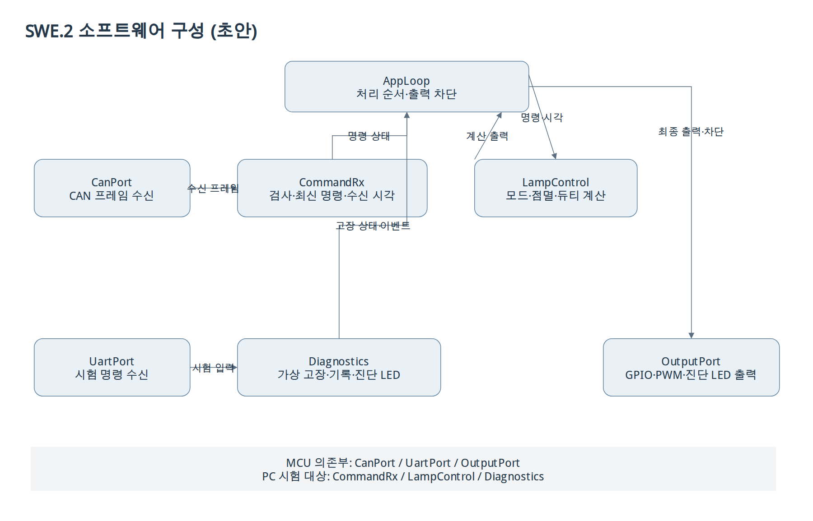
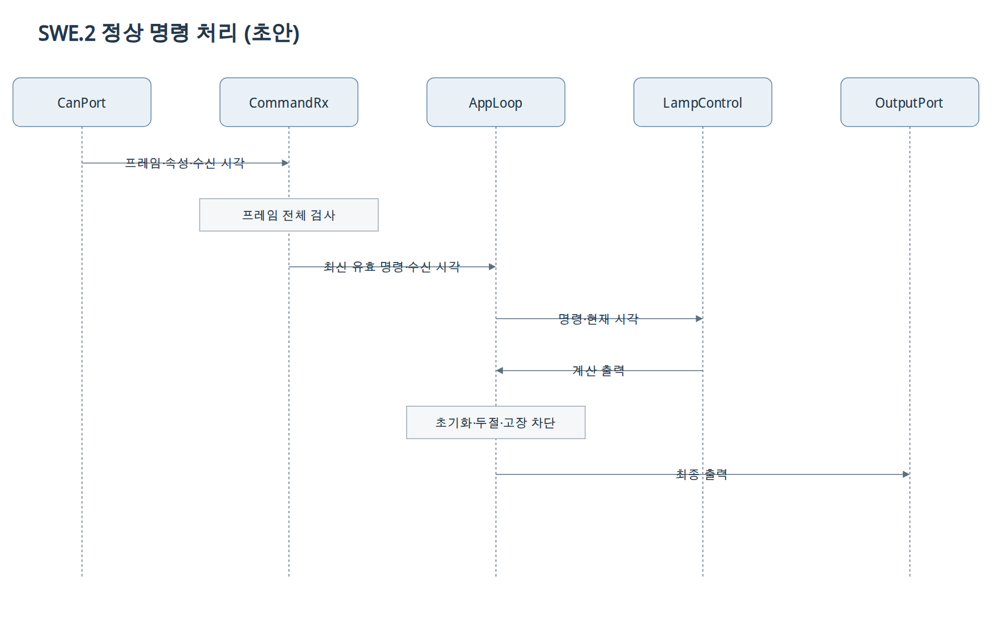
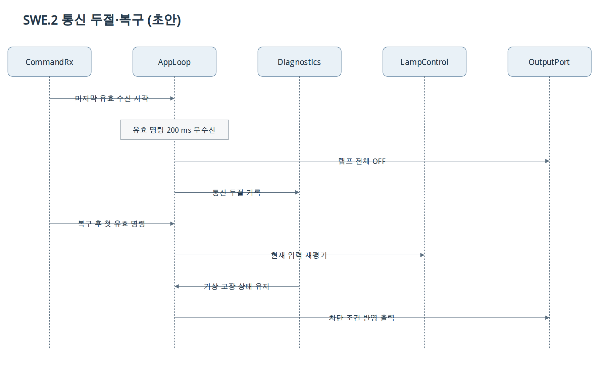
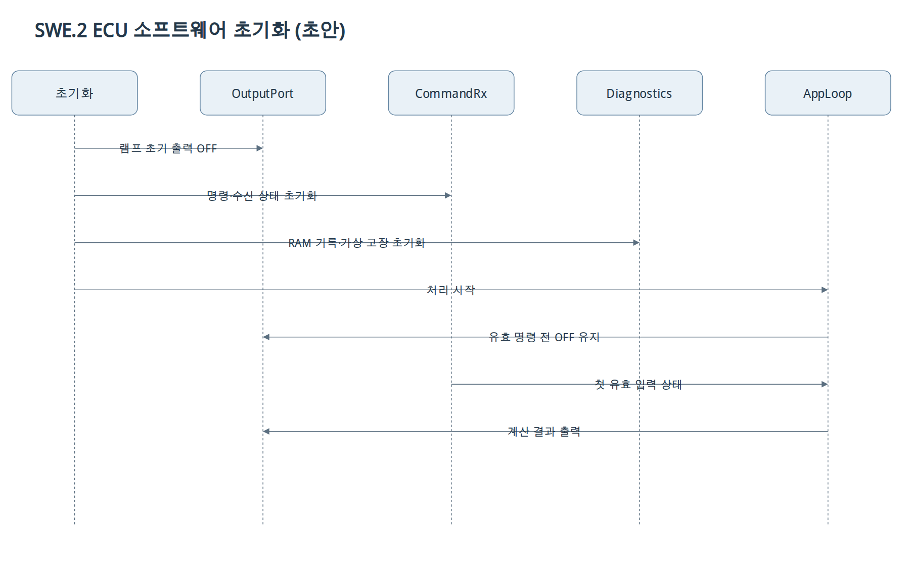
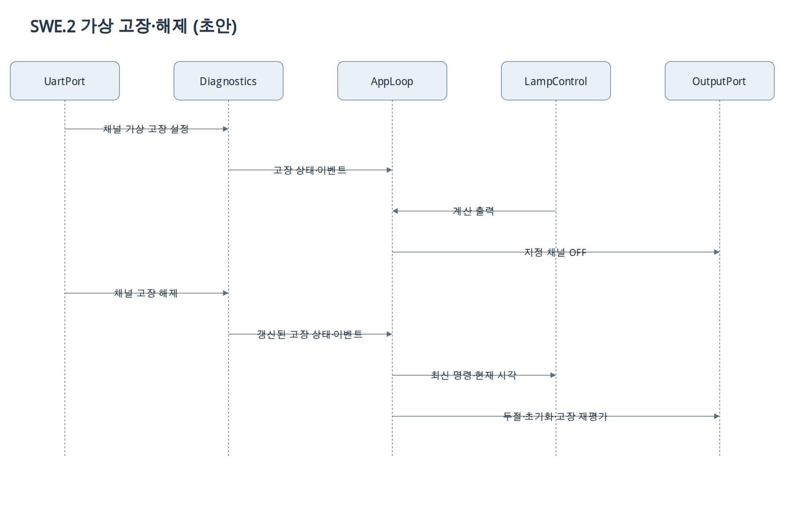

# SWE.2 소프트웨어 아키텍처

상태: 검토 초안. 구현·인터페이스 확정 전 단계.
대상: STM32에서 실행되는 소프트웨어. 외부 BCM·트랜시버·LED는 [실행 환경](project-scope.md).

## 정적 구조

[diagrams.net 원본](../diagrams/source/software-architecture.drawio)

| 컴포넌트 | 책임 | 주요 인터페이스 |
|---|---|---|
| CanPort | HAL CAN 수신·프레임 메타데이터 전달 | CanFrame {id, dlc, flags, data}, 수신 시각 |
| CommandRx | DBC 해석·유효성 검사·최신 명령·마지막 정상 수신 시각 | LampCommand {ign,turn,hazard,tail,brake,reverse}, 수신 상태 |
| LampControl | IGN·우선순위·점멸·미등/제동 출력 계산 | LampCommand + now_ms → LampOutputs |
| Diagnostics | 가상 고장 마스크·최근 16건 이벤트·진단 LED 진행 상태 | fault_mask, 이벤트 입력, UART 명령 결과 |
| OutputPort | 6채널 GPIO/PWM 반영·진단 LED 출력 | LampOutputs + 진단 LED 상태 → HAL |
| UartPort | 시험 UART 수신·명령 전달 | 수신 문자열 → Diagnostics |
| AppLoop | 초기화·처리 순서·안전 차단·모듈 호출 | 명령 유효성·두절·가상 고장 → 최종 출력 |

예정 경로: CanPort/OutputPort/UartPort는 MCU 의존부, CommandRx/LampControl/Diagnostics는 PC 시험 가능한 제어부.
AppLoop는 통신 두절·초기 수신 전 전체 OFF, 가상 고장 채널 OFF를 최종 출력에 적용.
함수명·C 타입·버퍼 크기·컴파일 경계는 SWE.3 상세 설계 대상.

## 동적 흐름

| 흐름 | 모듈 동작 | 요구사항 |
|---|---|---|
| 정상 수신 | CanPort → CommandRx 검사·명령 저장 → AppLoop → LampControl 계산 → 최종 차단 조건 → OutputPort | SWR-001~011,019 |
| 통신 두절·복구 | CommandRx 정상 수신 시각 확인 → AppLoop 전체 OFF·진단 이벤트 → 새 유효 명령 시 현재 상태 재평가 | SWR-003,013~015,017 |
| 재부팅 | OutputPort 초기 OFF → CommandRx·Diagnostics 상태 초기화 → 최초 유효 명령까지 OFF | SWR-012,018 |
| 가상 고장·CLEAR | UartPort → Diagnostics 고장 마스크 → AppLoop 최종 출력 마스킹 → CLEAR 후 현재 명령·통신 상태 재평가 | SWR-016~018 |

## 실행·동시성

- 실행 방식 후보: 인터럽트 수신 + 비차단 메인 루프. RTOS 미사용
- 인터럽트: 수신 자료 보관·메인 처리 통지 중심. 램프 점멸·UART 대기 처리 제외
- 명령 적용: 프레임 전체 검증 후 일괄 갱신. 인터럽트와 메인 간 데이터 일관성 확보 필요
- 모의 시각: PC 시험에서 공급 가능한 단조 증가 시각. 카운터 순환 처리의 상세 설계 필요
- 진단 LED: CAN 수신·램프 업데이트와 독립 진행. 블로킹 지연 금지

## 설계 검토

| 선택 | 이유 | 확인할 항목 |
|---|---|---|
| CAN 해석과 램프 계산 분리 | DBC 변경과 제어 규칙 변경의 영향 구분 | 인터페이스·통합 시험 |
| HAL 의존부 분리 | 실제 제어 C 코드의 PC 시험 | 가짜 출력이 아닌 동일 제어 코드 사용 |
| 최종 출력 차단의 단일 위치 | 통신 두절·가상 고장 우선순위 일관성 | CLEAR·복구·재부팅 조합 |
| 비차단 메인 처리 | 400 ms 점멸 중에도 신규 명령·복구 처리 | 실행 주기·최악 처리 시간·버퍼 크기 |

명시된 수치는 요구사항 목표. 실행 시간·메모리 사용량·실물 파형 측정 결과 없음.
[요구사항 할당]([SWE.1]traceability.md) · [CAN 인터페이스]([SWE.2]can-interface.md)
