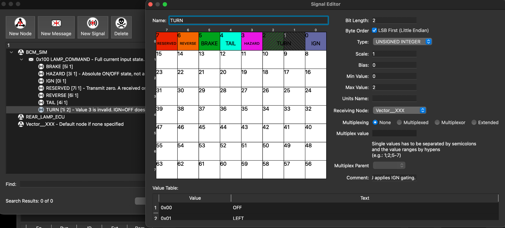

# SYS.3 CAN 인터페이스

BCM Simulator(UNO Q)가 운전자 입력 전체를 보내고 Rear Lamp ECU(STM32)가 수신한다.
[DBC 파일](../can/vehicle-lamp.dbc)을 기준으로 송수신 코드를 구현한다.

## 메시지

| 항목 | 정의 |
|---|---|
| 통신 | Classical CAN, 표준 11비트 ID, 500 kbit/s |
| 메시지 | LAMP_COMMAND, ID `0x100`, DLC 1 |
| 송신 → 수신 | BCM_SIM → REAR_LAMP_ECU |
| 송신 시점 | 입력 변경 시 즉시 전송 + 50 ms 주기 전송 |
| 타임아웃 | 마지막 유효 메시지 수신 후 200 ms 동안 유효 메시지가 없으면 6채널 OFF |
| 복구 | 첫 유효 메시지의 현재 입력 상태 적용. 가상 고장 채널은 CLEAR 전까지 OFF 유지 |

## 신호 배치

모든 신호는 unsigned, Intel, scale 1, offset 0이다.

| 신호 | 시작 비트 | 길이 | 값 |
|---|---:|---:|---|
| IGN | 0 | 1 | 0 OFF / 1 ON |
| TURN | 1 | 2 | 0 OFF / 1 LEFT / 2 RIGHT / 3 무효 |
| HAZARD | 3 | 1 | 0 OFF / 1 ON |
| TAIL | 4 | 1 | 0 OFF / 1 ON |
| BRAKE | 5 | 1 | 0 RELEASED / 1 PRESSED |
| REVERSE | 6 | 1 | 0 NOT_R / 1 R |
| RESERVED | 7 | 1 | 송신 시 0, 수신 시 1이면 메시지 전체 무효 |

ID·프레임 종류·DLC·신호 값을 검사하며 무효 메시지는 마지막 유효 수신 시간을 갱신하지 않는다.
주기 송신, 타임아웃 및 무효값 처리는 DBC를 읽는 것만으로 실행되지 않으며 펌웨어에서 구현한다.
500 kbit/s 속성 역시 메타데이터로, 양쪽 CAN 컨트롤러에 별도 설정해야 한다.

## 설계 이유

- 필요한 입력은 7비트이므로 1바이트에 전체 상태를 함께 전달한다.
- `0x100`은 프로젝트 내부 식별자이며 표준 지정값이나 수신 장치 주소가 아니다.
- 주기적으로 현재 상태를 전달해 ECU 재부팅 후 재동기화와 통신 끊김 판단에 사용한다.
- HAZARD는 버튼 누름 이벤트가 아닌 현재 ON/OFF 상태다. 버튼 토글 상태는 BCM이 관리한다.
- HAZARD 동작 중에도 TURN 값을 전달한다. 비상등 해제 시 ECU가 현재 IGN·TURN으로 모드를 결정한다.

## 도구 검토

AI로 작성한 초안을 SavvyCAN에서 열어 메시지와 신호 배치를 검토하고 수신 노드를 지정해 저장했다.
아래는 수정 전 검토 화면이며, 이후 수신 노드를 `REAR_LAMP_ECU`로 지정했다.
저장된 파일에서는 모든 신호의 수신 노드와 비트 배치, 50 ms 주기가 원본과 일치했다.
초기 화면에서 기본 수신 노드로 표시된 원인은 확인하지 못했다.



SavvyCAN 저장본에서 VERSION, 전체 설명 및 일부 버스 속성이 누락되어 원본 DBC를 관리 기준으로 유지한다.

cantools 45.1.2로 PC에서 파일 읽기와 인코딩·디코딩을 검사했다.

| 검사 | 결과 |
|---|---|
| 정상 입력 96조합 | 수동 비트 계산과 인코딩 일치, 디코딩 원복 확인 |
| 가능한 데이터 256개 | 참조 수신 규칙에서 정상 96개 / 무효 160개 분류 |
| ID·DLC·길이·프레임 종류 오류 9개 | Python 참조 수신 규칙에서 거부 |

실제 ECU 코드·CAN 버스·송신 주기·타임아웃·출력 응답 시간은 아직 검증하지 않았다.

재현 방법:

```sh
python3 -m pip install -r can/can-design-requirements.txt
python3 can/check_can_interface.py
```

[검사 스크립트](../can/check_can_interface.py) · [실행 결과](../can/CAN-interface-check-results.json)
