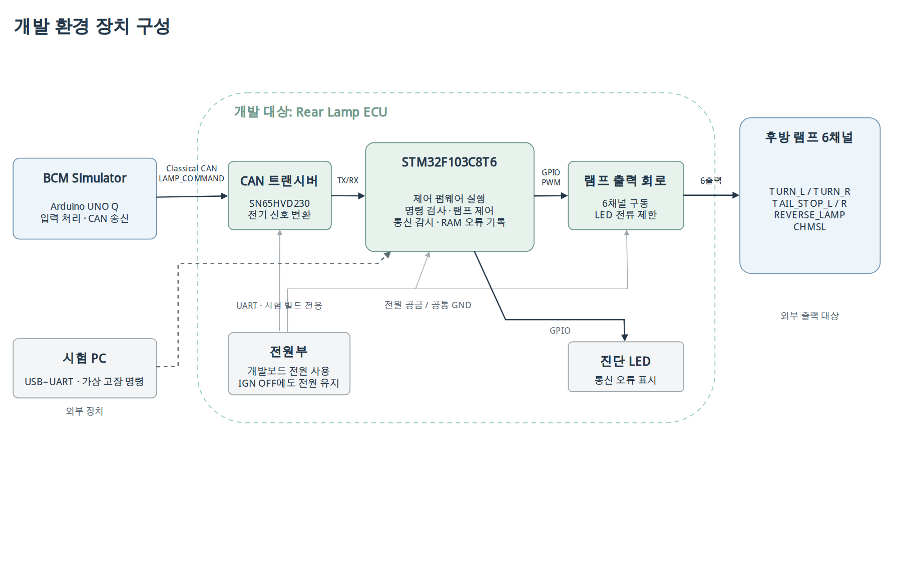

# 실행 환경과 외부 인터페이스

[diagrams.net 원본](../diagrams/source/hardware-overview.drawio) · [SVG](../diagrams/hardware-overview.svg)

| 요소 | 역할 |
|---|---|
| UNO Q BCM | 운전자 입력 해석·토글 상태 관리·CAN 명령 송신 |
| CAN 트랜시버 | MCU 논리 신호와 CAN 버스 연결 |
| Rear Lamp ECU | STM32·전원·트랜시버·출력 구동회로·펌웨어 |
| 램프 | 6개 논리 출력 채널 |
| UART·진단 LED | 시험 명령·상태 관측 |

이 그림의 대상: 장치·외부 인터페이스. SW 내부 컴포넌트 설계와 구분.
CAN FD: STM32F103 내장 bxCAN 범위 밖. 외장 컨트롤러 또는 MCU 변경이 필요한 후속 검토.
회로·핀·타이머·출력 극성은 HW/SW 인터페이스와 도구 설정에서 확정.
