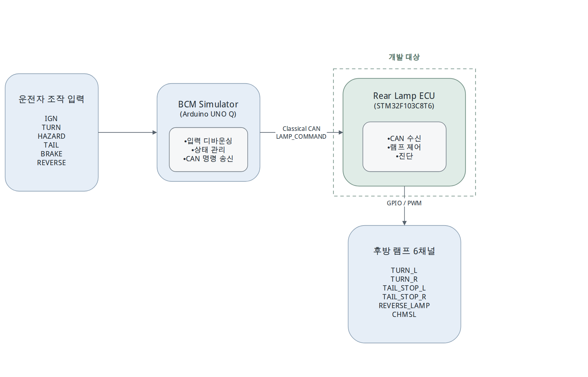

# 개발 범위와 입력 조건

대상: STM32F103C8T6 기반 후방 램프 제어 소프트웨어와 외부 연결 회로.
외부 BCM: Arduino UNO Q의 운전자 입력 해석·램프 상태 명령 송신.
출력: TURN_L/R, TAIL_STOP_L/R, REVERSE_LAMP, CHMSL의 6개 논리 채널.
포함: Classical CAN·방향지시·비상등·미등·제동·후진·시험용 진단.
제외: 전방 조명·AUTO·실제 LED 단선/단락 검출·전체 차량 BCM.

## 기능 목표

| ID | 입력 목표 |
|---|---|
| PRJ-001 | CAN 명령에 따른 후방 램프 제어 |
| PRJ-002 | 좌·우 방향지시 독립 제어 |
| PRJ-003 | 비상등 좌우 동기 점멸·일반 방향지시 대비 우선 |
| PRJ-004 | 일정 점멸 주기와 일관된 모드 전환 |
| PRJ-005 | 좌우 공용 미등·제동등, 제동 우선 |
| PRJ-006 | 브레이크 요청 기반 CHMSL 독립 출력 |
| PRJ-007 | 후진등과 다른 허용된 램프의 동시 동작 |
| PRJ-008 | IGN에 따른 기능 허용·차단 |
| PRJ-009 | IGN 변화·ECU 재부팅 후 현재 입력 상태 반영 |
| PRJ-010 | 초기화 중 의도하지 않은 점등 방지 |
| PRJ-011 | 무효 명령 거부와 이전 정상 상태 보호 |
| PRJ-012 | 시험용 가상 고장·해제·이벤트 기록 |
| PRJ-013 | 통신 두절 소등·복구 |
| PRJ-014 | BCM의 IGN·TURN·HAZARD·TAIL·BRAKE·REVERSE 전달 |
| PRJ-015 | IGN OFF에서도 허용된 조명의 동작 |
| PRJ-016 | PC 논리 시험과 실제 출력·통신 시험의 재현성 |

## 환경 조건

IGN OFF: 비상등·미등·제동 허용, 일반 방향지시·후진 차단.
IGN은 논리 입력이며 ECU 전원 유지와 별개.
비상등 우선·제동 우선, 초기화 중 의도하지 않은 점등 방지.
CAN FD는 MCU·컨트롤러 변경을 포함한 후속 검토 범위.

전체 응답 목표: 물리 조작→출력 ≤50 ms. 외부 BCM 처리·CAN 전달·ECU 처리 포함.
ECU 단독 SW 응답 기준과 구분.

[diagrams.net 원본](../diagrams/source/environment-context.drawio)

상세 장치 구성: [환경 문서](environment.md).
